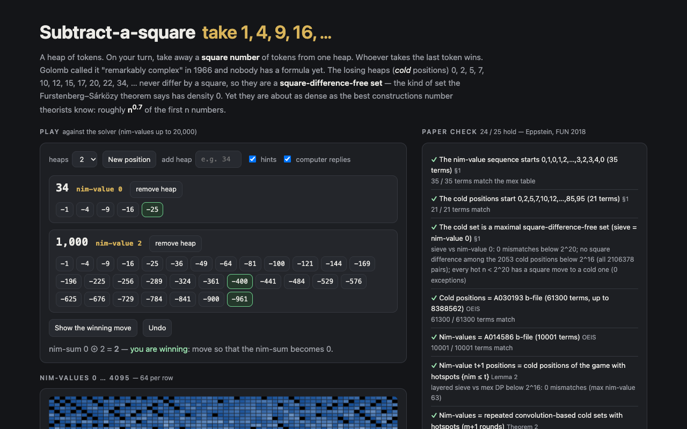

# Subtract-a-square

Take a square number of tokens (1, 4, 9, 16, …) from one heap; whoever takes the last token wins.
This repo plays the game in the browser against an exact solver (sums of up to three heaps, solved
by nim-values), and re-checks every checkable statement of

> David Eppstein, *Faster Evaluation of Subtraction Games*, FUN 2018 (LIPIcs 100), [arXiv:1804.06515](https://arxiv.org/abs/1804.06515)

against exhaustive computation: a sieve of all cold positions below 2³⁰, mex tables of all
nim-values below 2²⁴, and the OEIS b-files A030193 / A014586.



## What is in it

| file | |
|---|---|
| `src/sas.ts` | dependency-free solvers: mex DP, the sieve (§3.2), the layered sieve (Lemma 2), the divide-and-conquer with FFT Boolean convolution (Theorems 1–2), the Moser–de Bruijn game, Siegel's repeated-median fit |
| `src/main.ts` | the demo page (play, nim-value map, charts, paper check) |
| `tools/measure.mts` | the heavy run: sieve to 2³⁰ with digit histograms, DP to 2²⁴ with record maxima → `runs/measure.json` |
| `tools/verify.mts` | 25 checks against the paper → `runs/verify.json` (the page reads this file; no number on it is typed by hand) |
| `tests/` | 12 vitest tests |

## Setup

```sh
npm install
npm test                       # 12 tests
node tools/measure.mts 30 24   # ~30–40 min, ~200 MB RAM; smaller: node tools/measure.mts 24 20
node tools/verify.mts          # ~40 s, fetches the OEIS b-files into runs/.cache/ if online
npm run dev                    # http://localhost:5173/portfolio/subtract-a-square/
npm run build
```

Node 22.6+ (runs `.mts` with type stripping).

## Results in short

See the "paper check" panel of the demo or `runs/verify.json`. Everything that can be recomputed
matches (prefixes, OEIS b-files, Lemma 2, Theorems 1–2, the Moser–de Bruijn formula, the fitted
exponents 0.351 and ≈ 0.7, the base-5/7/13 digit pictures, the break-even estimates): **24 of 25
checks hold**. The exception is a typo:

- §3.3 writes the density of a perfect base-5 strategy as n^{log₁₀ 25} ≈ n^0.71534. log₁₀ 25 is 1.398
  (more than n elements in [0, n]); the value 0.71534 is log₂₅ 10. Base and argument are swapped.

Measured below 2³⁰: 1,816,355 cold positions, repeated-median exponent 0.6983 (paper: ≈ 0.7). Largest
nim-value below 2²⁴: 450, exponent 0.3507 (paper: 0.351). Base-5 ones digit outside {0, 2}: 2.28 %
(99.9 % of those are digit 4), down from 13.2 % at 2¹⁴. The twenty-fives digit stalls at ≈ 60 % {0, 2}
from 2²⁶ on, while the base-13 ones digit keeps climbing towards {0, 2, 7} (75.2 %).

## License

MIT

<!-- sen-publish:links -->
## Links

- 🌐 Demo: https://sen.ltd/portfolio/subtract-a-square/
- 📝 記事: https://qiita.com/sen-ltd/items/d8fe2861d2bfc18b82e2
<!-- /sen-publish:links -->
